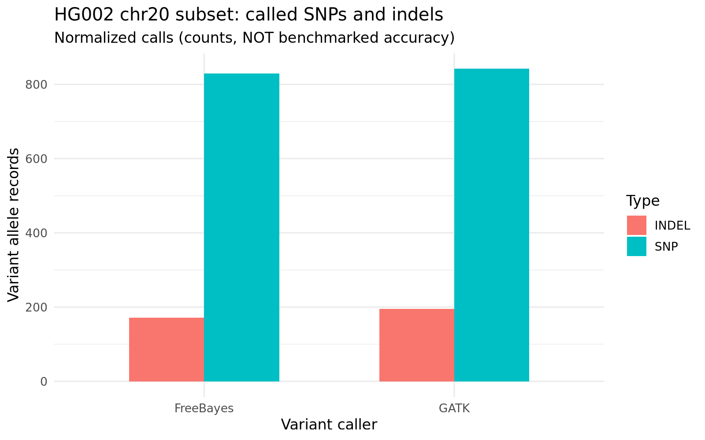
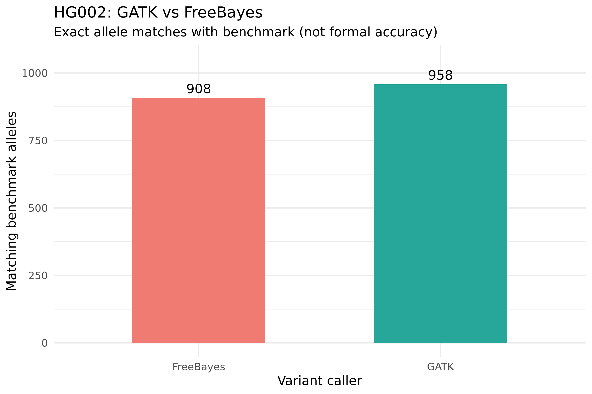
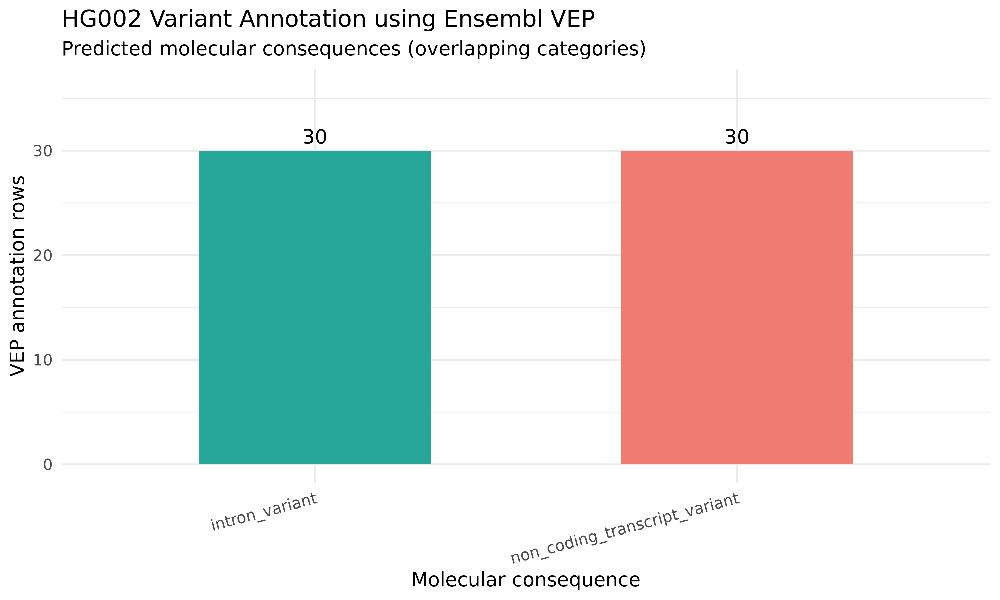

# HG002 Germline Variant Calling | GATK HaplotypeCaller vs FreeBayes

**End-to-end educational NGS analysis** of publicly available Genome in a Bottle (GIAB) HG002 paired-end reads from a **500,001-bp GRCh38 chromosome 20 region**. I performed FASTQ quality assessment, read trimming, alignment, duplicate marking, independent germline variant calling, normalization, preliminary truth-set comparisons, manual IGV investigation, Python/R visualization, and Ensembl VEP annotation.

> **Scope and status:** Completed exploratory analysis with measured results below. The automated scripts have been updated to reflect the manual analysis, but **have not yet been validated by a fresh end-to-end run**. This is an educational project, **not a clinical diagnostic pipeline**. Exact-allele matches are **not formal variant-calling accuracy**.

## Analysis overview

```text
HG002 paired-end FASTQ + local chr20 reference
    |-- FastQC / MultiQC (raw read QC)
    |-- fastp (adapter detection and quality trimming)
    |-- FastQC / MultiQC (post-trimming QC)
    v
BWA-MEM alignment -> SAMtools coordinate-sorted BAM + BAM index
    v
GATK MarkDuplicates (flags duplicates, does not remove by default)
    |------------------------------|
    v                              v
GATK HaplotypeCaller           FreeBayes
    |                              |
    +------- BCFtools norm --------+
                   |
        Exact allele-level overlap
                   |
    Comparison against HG002 truth VCF (exploratory)
                   |
      IGV review + Python/R plots + Ensembl VEP
```

## Main tools

| Stage | Software |
|---|---|
| Read QC | FastQC, MultiQC |
| Trimming | fastp |
| Mapping | BWA-MEM |
| BAM processing | SAMtools, GATK MarkDuplicates |
| Variant calling | GATK HaplotypeCaller, FreeBayes |
| VCF processing and exploratory truth matching | BCFtools |
| Visual examination | IGV |
| Analysis and plots | Python, R/ggplot2 |
| Variant consequence prediction | Ensembl VEP (Human GRCh38.p14; GENCODE 50) |
| Workflow | Linux/WSL2, Bash, Conda, Git |

## Dataset and coordinate conventions

- **Sample:** HG002 (NA24385), Genome in a Bottle reference individual.
- **Input:** Approximately **45,574 paired-end read pairs**, from a *teaching fixture* covering GRCh38 chromosome 20 positions 10,000,000–10,500,000 inclusive.
- **Local reference name:** `chr20_10.0-10.5Mb`, with coordinates 1–500,001.
- **Conversion for external GRCh38 variant annotation:** `GRCh38_chr20_pos = local_pos + 9,999,999` (only for this pinned fixture).
- **Important:** Do not mix local BAM/VCF coordinates with IGV's built-in full GRCh38 genome. IGV viewing used the custom reference FASTA. A VEP export was converted separately, with the genomic alleles requiring independent GRCh38 REF validation before stronger biological conclusions.
- **Fixture documentation:** [Lungfish Genome Explorer HG002 chr20 fixture](https://github.com/dhoconno/lungfish-genome-explorer/tree/v2026.9.39/docs/user-manual/fixtures/hg002-chr20). Credit goes to the data providers and fixture authors; the sequencing data are not generated by this repository.

## Experimental results

### 1. Read quality before and after fastp

| Metric | Raw reads | Trimmed reads |
|---|---:|---:|
| Total reads (R1 and R2 combined) | 91,148 | 82,458 |
| Q30 bases | 91.28% | 98.66% |
| GC content | 39.40% | 39.12% |
| Mean R1 length | 248 bp | 229 bp |
| Mean R2 length | 248 bp | 210 bp |

**Interpretation:** After trimming, retained bases had a higher Q30 fraction. Approximately 90.47% of reads were retained; trimming also removed sequence and may affect site-specific coverage. A better Q30 distribution alone does not establish improved variant-call accuracy.

### 2. Alignment and duplicate marking

- Reference breadth with nonzero read coverage: **99.922%** (499,611 / 500,001 bases).
- Mean depth: **36.20×**.
- Mean base quality: **Q38.6**.
- Mean mapping quality: **60**.
- GATK MarkDuplicates percent duplication: **1.70%**; 701 read-pair duplicates in Picard metrics (including six optical-duplicate pairs).

**Interpretation:** Broad coverage and high mean mapping quality are encouraging, but neither metric guarantees sufficiently strong evidence at every position. Coverage breadth must not be confused with the fraction of reads mapped.

### 3. Normalized variant records

Counts were produced from normalized, split allele records using `scripts/variant_summary.py`; these are **not counts of distinct genomic positions**.

| Variant type | GATK HaplotypeCaller | FreeBayes |
|---|---:|---:|
| SNP | 842 | 829 |
| Indel | 195 | 171 |
| Other | 5 | 18 |
| **Total** | **1,042** | **1,018** |



### 4. Agreement between callers

Using BCFtools normalization and `isec -c none` (exact `CHROM,POS,REF,ALT` identity):

- **Shared allele records:** 950.
- **GATK-only allele records:** 92.
- **FreeBayes-only allele records:** 68.
- **Jaccard overlap:** `950 / (950 + 92 + 68) = 85.59%`.

This is *allele overlap*, not concordance of genotypes, and not biological accuracy.

### 5. Preliminary HG002 truth-VCF matching

Truth VCF after normalization: **976 allele records**.

| Exact allele-match category | GATK | FreeBayes |
|---|---:|---:|
| Alleles matching the truth VCF | 958 | 908 |
| Truth alleles without an exact caller match | 18 | 68 |
| Caller alleles without an exact truth-VCF match | 84 | 110 |



**Caution:** These counts are descriptive exact-allele comparisons only. No validated, matching high-confidence-region BED mask or genotype-/haplotype-aware evaluator has been applied and verified. Therefore the unmatched categories must **not** be called confirmed false positives/negatives, and **precision, recall, sensitivity, specificity and F1 are not claimed**. Variant representation and the trustworthiness of the sample/fixture relationship require careful assessment.

### 6. Manual IGV case study: un-recovered insertion

The normalized teaching truth VCF reports **local position 14,155: `T > TAA`, `GT=1/1`**. The position is in an A-rich region. Neither caller reported a corresponding call in the inspected local window. Manual BAM and SAMtools inspection showed:

- **Seven** pileup observations at the reference anchor, all matching `T`.
- No directly observed `+2AA` insertion at the anchor in that pileup.
- A selected read had `75M` CIGAR and MAPQ 60; nearby reads included soft clipping.
- Depth decreased sharply just downstream of the anchor.

**Interpretation:** Unresolved benchmark/caller discrepancy with limited local evidence. This is *not proof* that the truth VCF or either caller is wrong. Alignment ambiguity, trimming, coverage and allele representation could matter. See `docs/RESULTS.md` and `docs/IGV_GUIDE.md`.

### 7. Ensembl VEP annotation (selected subset)

A manually selected **30-record** VCF was converted from local slice coordinates to GRCh38 and annotated on the VEP website using Human GRCh38.p14 and GENCODE 50. The downloaded result contained **30 annotation rows**. The visible/parsed annotations were associated with **ANKEF1**; all 30 rows included both `intron_variant` and `non_coding_transcript_variant` consequences.



**Caution:** VEP annotations are *transcript-dependent predictions*, not clinical interpretations. These consequence categories **overlap** and refer to annotation rows, **not 60 separate variants**. Two distinct uploaded indels collapsed to the same simple `Location + Allele` key in the TSV; the file did not reliably preserve unique input IDs. Accordingly the plot does not claim 30 individually reconciled VEP variant IDs. This selection is not representative of the whole VCF.

## Reproduce the analysis (Linux / WSL2 Ubuntu)

This repository is intended to run from its root directory. The following scripts are supplied for reproducibility; because they were edited after the exploratory run, **full end-to-end parity remains to be tested**.

```bash
# Create a new conda environment from the project specification
conda env create -f environment.yml
conda activate hg002-variants

# Obtain the public fixture data, then run QC + trimming + variant calling
bash scripts/01_download_inputs.sh
bash scripts/02_run_calling.sh
bash scripts/03_compare_callers.sh

# Produce CSV summary; outputs remain local in results/
python scripts/variant_summary.py

# Generate R plots in a separate environment if needed
conda create -n rplots -c conda-forge r-base r-ggplot2 -y
conda activate rplots
Rscript scripts/plot_variants.R
Rscript scripts/plot_benchmark.R
Rscript scripts/plot_vep_consequences.R
```

For the two latter plots, the summary CSVs and VEP output used for this exploratory run must be available under the expected paths. Small *published summary tables* are available in `reports/`. The VEP web submission and IGV inspection are manual, not completely automated.

**Optional benchmarking:** `scripts/04_benchmark_optional.sh` is provided as an experimental starting point. Do **not** use it to report formal metrics without first confirming compatibility of the GIAB truth release, confident-region BED intervals, reference and genotypes. Avoid tuning on the same truth data used to report final performance.

## Repository contents

```text
README.md                   Project overview and measured results
environment.yml             Primary bioinformatics environment
scripts/                    Data download, QC/calling, comparison and analysis scripts
docs/RESULTS.md             Detailed results and limitations
docs/IGV_GUIDE.md          IGV inspection instructions
docs/INTERVIEW_PREP.md     Questions and explanations for interview preparation
docs/input_checksums.sha256 Input-file checksums for independent verification
reports/                   Small summary CSV tables
figures/                   Three exported comparison and annotation plots
```

Raw FASTQs, reference FASTA, BAMs, VCFs, large QC files and full VEP downloads are intentionally excluded via `.gitignore`; they stay on the local machine. Input checksums aid reproducibility, but **are not a guarantee that the pipeline has been rerun successfully**.

## Limitations and next improvements

- Run the updated scripts from a clean directory and verify that all results agree with the recorded manual experiment.
- Confirm data/fixture provenance, high-confidence-region boundaries and genotype-aware variant assessment using `hap.py` or RTG `vcfeval`.
- Document base-recalibration choices, depth stratification, filtering thresholds, genotype agreement and caller disagreement.
- Test raw vs trimmed reads under a controlled, otherwise identical workflow.
- Verify VEP REF alleles against full GRCh38 and annotate a representative variant subset or the entire callset.
- Fix FreeBayes legacy GQ metadata for strict downstream compatibility after inspecting the actual field values.

## References

- [GIAB: Genome in a Bottle](https://www.nist.gov/programs-projects/genome-bottle)
- [HG002 chr20 teaching fixture](https://github.com/dhoconno/lungfish-genome-explorer/tree/v2026.9.39/docs/user-manual/fixtures/hg002-chr20)
- [GATK HaplotypeCaller](https://gatk.broadinstitute.org/hc/en-us/articles/360036359552-HaplotypeCaller)
- [BCFtools](https://samtools.github.io/bcftools/)
- [IGV](https://igv.org/doc/desktop/)
- [Ensembl VEP](https://www.ensembl.org/Tools/VEP/)

---

**Author:** GitHub user [gdakshareddybt23](https://github.com/gdakshareddybt23). Conducted as a self-directed educational bioinformatics portfolio project using public, third-party sequencing data.
